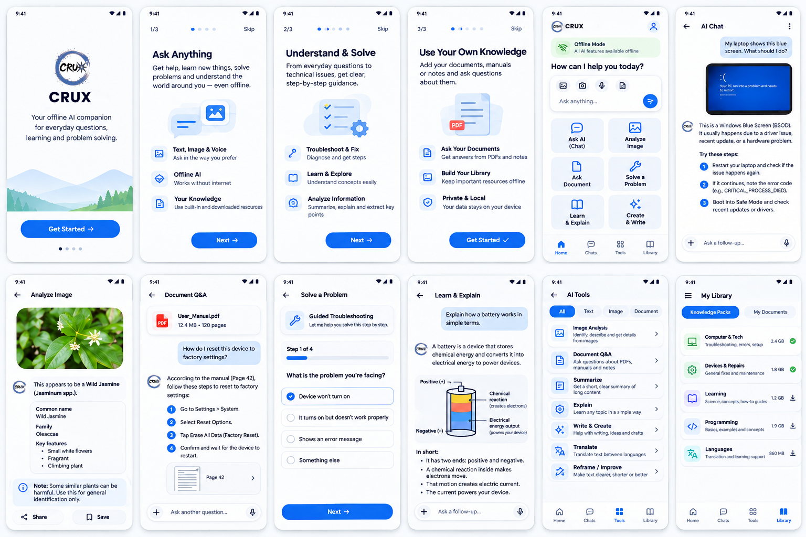
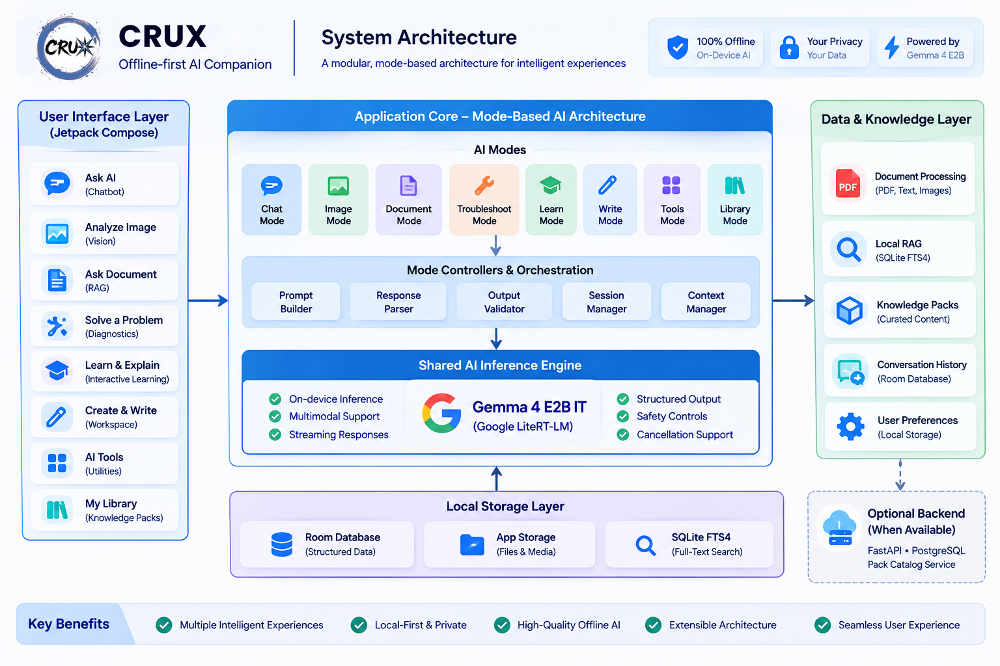
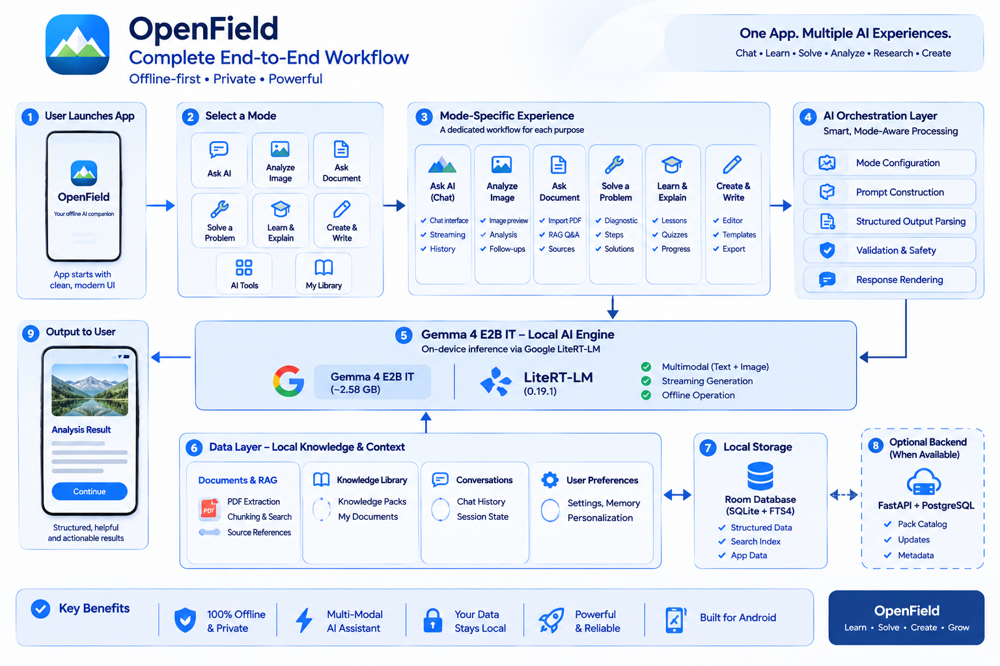

# OpenField — Offline-First Android AI Companion

<p align="center">
  <strong>Knowledge should never depend on connectivity.</strong>
</p>

<p align="center">
  <a href="https://github.com/itzdineshx/openfield-ai/releases/latest">
    
  </a>
  <a href="https://github.com/itzdineshx/openfield-ai/actions/workflows/android-ci.yml">
    
  </a>
  
  
  
  <a href="LICENSE">
    
  </a>
</p>

---

## Overview

**OpenField** is an open-source, **100% offline-first Android AI companion** designed for everyday assistance, learning, document knowledge, visual analysis, and practical problem solving.

Unlike generic cloud chatbots wrapped in webviews, OpenField runs **entirely on-device** using **Gemma 4 E2B IT** via **Google LiteRT-LM**. Your conversations, imported documents, camera captures, and personal notes remain strictly on your device—providing dependable intelligence even in airplane mode, remote locations, or during network blackouts.

<p align="center">
  
</p>

---

## Core Workspaces & Capabilities

OpenField enforces strict **mode contracts**, providing purpose-built interfaces for each task rather than forcing everything into a generic text transcript:

- 💬 **Ask AI (Conversational Chat):** General-purpose chat with streaming generation, cooperative cancellation, and a comprehensive assistant action row:
  - **Copy:** 1-tap markdown copy to clipboard.
  - **Bookmark / Save Answer:** Save answers directly into **My Library** (`saved_answers`) with active state toggling.
  - **Read Aloud (TTS):** Native Android text-to-speech audio narration with play/stop toggle.
  - **Share:** Instant system chooser (`Intent.ACTION_SEND`) to share text with any Android app.
- 📄 **Ask Document (Local Grounded RAG):** Import PDFs and text notes via Android Storage Access Framework (SAF). Text is extracted asynchronously with page boundary preservation, indexed in local SQLite FTS4, and queried with verifiable, tappable source page citations and an Evidence Explorer sheet.
- 📷 **Analyze Image (Multimodal Vision):** Snap photos directly via in-app camera or pick from the gallery. Validates image dimensions and orientation locally, performing on-device visual reasoning with structured observations and contextual follow-up questions.
- 🛠️ **Solve a Problem (Diagnostic Workflow):** Stateful diagnostic machine that turns open-ended issues into structured steps with cautions, expected observations, and branching based on user observations (*Yes / No / Not sure*).
- 🎓 **Learn & Explain (Interactive Tutor):** Adaptive tutor with level selection (*Beginner, Intermediate, Advanced*), structured lesson outlines, core concepts, analogies, multiple-choice quizzes with hints, and interactive flashcards.
- ✍️ **Create & Write (Document Studio):** Dedicated workspace to draft emails, reports, summaries, and notes. Adjust tone, length, or clarity with instant diff preview and local export to Markdown (`.md`) or text (`.txt`).
- 📚 **My Library (4-Section Architecture):**
  1. **Knowledge Packs:** Pre-curated authoritative offline domain guides (Linux systems, electronics repair, physics, Kotlin coroutines, linguistics).
  2. **My Documents:** User-imported PDFs with real-time extraction and indexing status.
  3. **Saved Answers:** Starred answers and snippets with markdown preview and deletion.
  4. **Downloads & Sideloading:** Verified download management with **.zip pack sideloading** via SAF and OTA updates via GitHub Releases CDN.
- 🔢 **AI Utilities & Tools:** Offline deterministic scientific math engine, unit converter with fluid physics animation, text summarizer, translator, and structured extractor.
- 🔒 **Privacy & Factory Reset:** Complete user data sovereignty with a master **"Clear All OpenField Data"** factory reset dialog that wipes user data while preserving the local ~2.58 GB Gemma 4 model artifact.

---

## System Architecture

OpenField follows modern Android Clean Architecture with unidirectional data flow (UDF), domain controllers, and strict separation between the UI, storage, retrieval, and inference boundaries.

<p align="center">
  
</p>

### Architecture Highlights:
- **Presentation Layer (Jetpack Compose & Material 3):** Single-activity architecture using Kotlin Coroutines, reactive `StateFlow`, and Material 3 design tokens.
- **Domain & Orchestration:** Independent mode controllers (`ChatController`, `DocumentQaController`, `CrossSourceQaController`, `ProblemSolverUseCase`, `LearningController`) decoupled from UI and engine implementation details.
- **Local AI Inference Engine:** Unified engine boundary leveraging Google LiteRT-LM to load `gemma-4-E2B-it.litertlm` on CPU with zero cloud inference fallback.
- **Local Persistence & Search:** Room over SQLite with SQLite FTS4 full-text search indexes, structured task sessions, and atomic transactions.
- **Pack Distribution Engine (`PackZipInstaller`):** Installs `.zip` bundles with Zip-Slip path traversal defense, SHA-256 cryptographic verification, and atomic database insertion.

---

## System Workflow & Data Flow

<p align="center">
  
</p>

### End-to-End Execution Lifecycles:

1. **Model Setup & Verification:**
   - Verifies device RAM, storage space, and CPU capabilities.
   - Computes SHA-256 hash before placing `gemma-4-E2B-it.litertlm` into app-private storage (`/files/models/`).
   - Initializes LiteRT-LM runtime on CPU with memory-mapped weights.
2. **Document Grounding (Local RAG Flow):**
   - User selects PDF/Text file via Storage Access Framework.
   - `PdfTextExtractor` extracts content while tagging page/section boundaries.
   - Text is normalized into discrete chunks and stored in Room with SQLite FTS4 index.
   - User queries are retrieved via BM25/FTS rank, injected into a bounded prompt template with strict anti-hallucination constraints, and streamed through Gemma 4.
3. **Knowledge Pack Distribution Flow ($0 Cloud Cost):**
   - **OTA Download:** Queries static catalog `packs.json` via GitHub Raw CDN. Downloads `.zip` archive via GitHub Releases CDN with HTTP 301/302 redirect support.
   - **Local Sideload:** Offline users copy `.zip` bundles to device storage or SD card and import via SAF.
   - `PackZipInstaller` unpacks manifest, structured `articles.json`, and markdown files, atomically writing them to Room `knowledge_pack_articles`.

---

## Technology Stack

| Layer | Technologies & Libraries |
|---|---|
| **Platform** | Android 8.0+ (API 26 – 35), Kotlin 2.4.21, Java 17 |
| **UI Framework** | Jetpack Compose, Material 3, Compose Navigation, Coil 2.7 |
| **Local AI Engine** | Google LiteRT-LM (`com.google.ai.edge.litertlm:litertlm-android:0.19.1`) |
| **Local Model** | Gemma 4 E2B IT (`gemma-4-E2B-it.litertlm`, ~2.58 GB) |
| **Persistence** | Room SQLite 2.7.2 with SQLite FTS4 full-text search |
| **Document Extraction** | PDFBox Android 2.0.27.0 |
| **Vision / OCR** | ML Kit On-Device Text Recognition (100% offline, zero cloud) |
| **Audio & Speech** | Android `SpeechRecognizer` (STT) + Android `TextToSpeech` (TTS) |
| **Background Tasks** | AndroidX WorkManager 2.9.1 + Kotlin Coroutines 1.11.0 |
| **Architecture** | Clean Architecture, MVVM, UDF, Repository Pattern |
| **Packaging & CI** | Gradle 9.7.1, AGP 9.3.1, KSP 2.3.14, GitHub Actions CI/CD |

---

## Getting Started & Development

### Prerequisites
- Android Studio Ladybug / Meerkat or newer.
- JDK 17 or JDK 21 (configured as Gradle JDK).
- Android SDK Platform 35.
- A physical Android device with at least 6 GB of RAM (ARM64) for local model execution.

### Building from Source

1. **Clone the repository:**
   ```bash
   git clone https://github.com/itzdineshx/openfield-ai.git
   cd openfield-ai/android
   ```

2. **Run the automated unit tests:**
   ```powershell
   .\gradlew.bat testDebugUnitTest
   ```
   *(All 202 unit tests run and pass in ~15 seconds)*

3. **Run Android Lint analysis:**
   ```powershell
   .\gradlew.bat lintDebug
   ```

4. **Build the Release APK:**
   ```powershell
   .\gradlew.bat :app:assembleRelease
   ```
   Output APK will be generated at:
   `android/app/build/outputs/apk/release/app-release.apk`

5. **Install on connected device via ADB:**
   ```powershell
   & "$env:LOCALAPPDATA\Android\Sdk\platform-tools\adb.exe" install -r "app\build\outputs\apk\release\app-release.apk"
   ```

---

## Packaging Knowledge Packs

To generate or update the offline Knowledge Pack `.zip` bundles and manifest for GitHub Releases:

```bash
python scripts/package_knowledge_packs.py
```

This outputs `.zip` bundles to `catalog/packs/` and generates `catalog/packs.json` with exact SHA-256 checksums and GitHub Release URLs.

---

## Privacy Commitment

OpenField is strictly local-by-default:
- **No Cloud Inference:** Prompts, images, documents, audio, and drafts are never sent to remote AI services.
- **No Telemetry or Tracking:** Zero tracking SDKs, analytics beacons, or behavioral logging.
- **On-Device Data Storage:** All databases, chat histories, extracted document chunks, and models reside in Android app-private storage.
- **User Control:** Users can clear specific conversations, remove documents, or execute a master factory reset at any time.

---

## License

OpenField is licensed under the [Apache License, Version 2.0](LICENSE).  
Third-party model weights (Gemma 4) and inference runtimes (LiteRT-LM) are subject to Google's terms and licenses.
